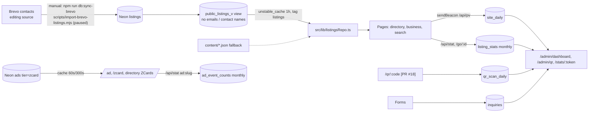

# PinoyPages: ad/listing engine and analytics engine on Neon

Status as of Nov 3, 2026. Sources: `main` at `11be2fc` (PR #17) plus **PR #18 `dashboards` (not merged)**. Items only in PR #18 are marked **[PR #18, unmerged]**. Migrations 001–006 are applied in production. **007 is pending and not applied.**

No keys, passwords or tokens appear in this document.

## 1. Overview

## 2. Listings pipeline

1. **Brevo is the editing source.**
   - `scripts/import-brevo-listings.mjs` (alias `npm run db:sync-brevo`) reads Brevo. It is read-only against Brevo.
   - It upserts FREE, UNVERIFIED, GTA-only business listings into Neon `listings`, keyed by `brevo_contact_id`.
   - Rows that stop qualifying get `status='hidden'`; nothing is deleted.
   - Each run writes a row to `sync_runs`. `--write-fallback` also refreshes `content/brevo-listings.json`.
   - The sync is run by hand only: there is no cron. It is currently **paused** by policy.
   - The reverse script, `scripts/sync-brevo.mjs`, pushes website listings *to* Brevo as contacts. It sends nothing.
2. **Public read model.** `public_listings_v` (migration 005) holds published rows only. It has no email, messenger handle or source column.
3. **Repo.** `src/lib/listingsRepo.ts` `getPublicListings()`:
   - Queries the view and caches the result with `unstable_cache` (`revalidate: 3600`, tag `listings`).
   - Falls back to the bundled JSON (`src/lib/public.ts`) when there is no `DATABASE_URL`, the query fails, or the table is empty.
   - Rows are merged with the JSON by `src/lib/listingsMerge.ts`.
   - Nothing calls `revalidateTag("listings")` yet, so a sync shows up on the site within about an hour.
4. **Tiers and Verified badge.**
   - `fromNeonRow` passes `tier`, `verified` and `verified_until` through. Verification that has expired shows no badge.
   - `src/lib/guide.ts`: `isPaid` means `tier === "verified"`. Badge states are none, pending, active, paused and expired (`src/components/Badge.tsx`).
   - Price is "$199 per issue", with a $99.50 loyalty rate (PR #16).

## 3. Ads, ZCards, slots

- **Ads and ZCards are served from the Neon `ads` table** (`src/lib/adsRepo.ts`):
  - `getAd` is cached for 60 s. `listZcards` (`tier='zcard'`, `status='live'`) is cached for 300 s. Both use tag `ads`.
  - If there is no database, they fall back to `content/ads.json`.
  - `searchZcards` does a text match for the directory search (`src/app/directory/page.tsx`).
- **Sponsored search:** `src/lib/sponsored.ts`, using `sponsored_placements` and `sponsored_event_counts` (monthly).
- **Tables created but not used by code yet:** migration 005 created `zcards`, `ad_slots`, `ad_bookings` and `ad_event_daily`, but no application code reads or writes them. `zcards.image_key` is designed for R2 images, and R2 isn't wired up yet.

## 4. QR codes and redirects

| Route | File | Behaviour |
|---|---|---|
| `/go/<id>[?via=scan\|tap\|call\|map\|web]` | `src/app/go/[id]/route.ts` | Paid listings only. Calls `track()`, which adds 1 to the **monthly** `listing_stats`, then redirects to tel:, the map, the website or `/card/<id>` with UTMs. |
| `/card/<id>` | `src/app/card/[id]/page.tsx` | Static ZCard bridge page per Verified listing, with a view beacon. |
| `/q/<ws\|cc\|fl\|eb>-<slug>` | `src/app/q/[code]/route.ts`, `src/lib/qrcodes.ts` | Print QR codes. Resolved from the JSON listings, not the database. Fires a GA4 `qr_scan` event and redirects to the business page. No database counter. |
| `/qr/<id>/<file>` | `src/app/qr/[id]/[file]/route.ts` | QR image files. |
| `/qr/<code>` **[PR #18, unmerged]** | `src/app/qr/[id]/route.ts` | Active `qr_codes` row → adds 1 to `qr_scan_daily` (code, day, device) → 302 redirect. The target must be `https://(www.)pinoypages.ca/go\|card/<id>`. A `/qr` target or any other host gets a 404. Check: `qrTarget()` in `src/lib/dashRange.ts`. |

Migration **007 (pending)**, `db/migrations/007_qr_target_check.sql`, adds a CHECK constraint so `qr_codes.target_url` must match `^https://(www\.)?pinoypages\.ca/(go|card|qr)/…`.

## 5. Inquiries

- Every form submission is handled by `saveInquiry()` (`src/lib/inquiries.ts`), which inserts it into `inquiries` (migration 006).
- The Google Sheet mirror was removed in PR #17. The `sheet_synced` column still exists but nothing uses it.
- **Owner email is gated off:**
  - `notifyEnabled()` (`src/lib/inquiryNotice.ts`) is true only when `INQUIRY_NOTIFY_ENABLED === "true"`. The default is OFF.
  - When enabled, the sender is PinoyPages <info@pinoypages.ca> and it goes to the owner's inbox via Brevo.
- Cleanup is done on demand only. Production has 0 rows as of Nov 3 after the test rows were deleted.

## 6. Analytics engine

**Design:** pre-aggregated counters. Each hit is one `insert … on conflict do update set n = n + 1`, so there is never one row per hit. There are no cookies, IP addresses, user agents or visitor ids (header of migration 005).

| Writer | Endpoint/file | Table | Key |
|---|---|---|---|
| Page views | `src/components/PageView.tsx` → `POST /api/pv` → `recordPageView` (`src/lib/siteAnalytics.ts`) | `site_daily` | day (Toronto), path, referrer host, device, event |
| Listing view/scan/call/map/website/tap | `/api/stat`, `/go/<id>` → `track()` → `store()` (`src/lib/analytics/store.ts`; Neon when `DATABASE_URL` is set, otherwise memory/JSON/Upstash) | `listing_stats` (monthly) | listing_id, month, event |
| QR ad pages `ad:<slug>` | `track()` → `recordAdEvent` | `ad_event_counts` (monthly) | ad, tracking id, month, event |
| Sponsored impressions/clicks | `recordSponsored` | `sponsored_event_counts` (monthly) | placement, month, event |
| Search queries | `src/lib/search.ts` | `search_log` | day, query, results |
| QR scans **[PR #18]** | `/qr/<code>` | `qr_scan_daily` | code, day, device |

Filters:
- Bots are filtered out (`isBot`).
- `/api/pv` honours Do Not Track and Global Privacy Control (DNT/GPC) and skips `/admin`, `/stats` and `/results`.

**Reads:**
- `src/lib/dashboards.ts` **[PR #18]** runs about 13 queries in parallel per range, cached with `unstable_cache` for 300 s per range or advertiser.
- Charts are inline SVG (`src/components/admin/Charts.tsx`), with no chart library.
- Correction from the design summary: **nothing writes `listing_event_daily` or `ad_event_daily`**, so the dashboard series for listing views, contacts and ad events stay at zero until `track()` also writes the daily tables.

## 7. Dashboards and access

- **Overall** **[PR #18]:** `/admin/dashboard?key=<ADMIN_KEY>&days=7|30|90`.
- **QR trackers** **[PR #18]:** `/admin/qr?key=<ADMIN_KEY>&days=…`.
- **Classic analytics:** `/admin/analytics?key=…`.
- **Advertiser list:** `/admin/advertisers?key=…`. It links each advertiser's private stats page, which is how admin can see every advertiser.
- **Admin key check:** `validAdminKey()` (`src/lib/analytics/token.ts`, timing-safe). A missing or wrong key gives a 404. Every admin page is noindex.
- **Advertiser view:** `/stats/<token>`, where the token is 36 hex characters (`advertisers.stats_token`, a random default in migration 003).
  - Shows monthly tables, plus **[PR #18]** a day-by-day section and that advertiser's QR codes.
  - Every query is filtered by `advertiser_id`.
  - The page is noindex and sends no referrer.

## 8. Tables

| Table | Migration | Purpose | Written by code | Prod rows (Nov 3) |
|---|---|---|---|---|
| listings / public_listings_v | 002/005 | directory listings and their public view | import script | n/a (falls back to JSON when empty) |
| sync_runs | 005 | sync audit | import script | n/a |
| advertisers, advertiser_listings | 003 | advertisers and stats tokens | admin/seed | 0 |
| ads, ad_tracking_ids, ad_event_counts | 001 | ads/ZCards and monthly events | yes | 0 |
| sponsored_placements, sponsored_event_counts | 005_zcard_search | sponsored search | yes | 0 |
| search_log | 005_zcard_search | search counts | yes | 5 |
| site_daily | 003 | page views | yes | 103 |
| listing_stats | 002 | monthly listing events | yes | 0 |
| listing_event_daily | 005 | daily listing events | **no** | 0 |
| qr_codes, qr_scan_daily | 005 | QR tracker | PR #18 (scans) | 0 |
| zcards, ad_slots, ad_bookings, ad_event_daily | 005 | planned booking engine | **no** | 0 |
| inquiries | 006 | form submissions | yes | 0 |

## 9. Cost and Cloudflare

- Pages use Neon serverless over HTTP (`src/lib/db.ts`), so there are no connection pools.
- Reads are cached for 1 h for listings, 1–5 min for ads, and 5 min for dashboards.
- Writes are single-row upserts.
- Cloudflare isn't wired up yet. Migration 005 mentions an "edge (Cloudflare Worker or Next route)" for QR codes and R2 for `zcards.image_key`. Only the Next.js route exists.

## 10. Known gaps

- `listing_event_daily`, `ad_event_daily`, `zcards`, `ad_slots` and `ad_bookings` are empty and unused.
- Listings, QR and ZCard charts will show zeros.
- Vercel previews have no `DATABASE_URL`. They use the JSON fallback, and the dashboards show "No database connected".
- Nov 3 includes about 467 test page views in `site_daily`. They are kept as-is.
- `/q/<code>` (GA only) and `/qr/<code>` (Neon counter) are two separate QR systems.
- Sync doesn't revalidate the cache, so changes can take up to an hour to appear.

## 11. Design review

**Benefits (checked against the code)**
- **Low cost:** Neon serverless over HTTP, cached reads (section 9) and pre-aggregated counters.
- **Resilience:** a JSON fallback for listings and ads when the database is missing or failing.
- **Brevo as the editing source**, with manual, idempotent sync that hides rows instead of deleting them.
- **Privacy by design:** no PII in counters; DNT/GPC are honoured; the public view leaves out contact data.
- **QR target lock:** enforced in code by `qrTarget()` **[PR #18]**, and in the database by 007 (pending).
- **Simple stack:** Next.js, Neon and SVG charts.

**Risks and recommendations**
1. **Top priority: reset the leaked Neon password.** The code can't confirm this either way. It is reported as not yet reset. Rotate it in Neon, then update `DATABASE_URL` in Vercel and in the local env files.
2. **Advertiser token links never expire.** There is no expiry or revoke column (migration 003). Add `stats_token_expires_at` plus a "rotate token" admin action.
3. **The admin key is passed in the URL (`?key=`)**, where it can end up in browser history and logs. Move it to an HttpOnly cookie session set by a login form.
4. **Previews have no database**, so they can't test DB features. Tests run against production also caused test rows (fixed by unsetting `DATABASE_URL` for tests). Use a Neon preview branch per PR through the Vercel integration.
5. **One database write per page view** (`/api/pv`) is fine at today's volume. At scale, batch the writes, for example with a Cloudflare Worker or a queue flushing every minute.
6. **At scale:** serve ZCard images from R2, and move QR redirects to a Worker with KV/edge caching.
7. **Connect the daily listing/ad counters** to `track()`, or drop those tables, so the dashboards show real data.
